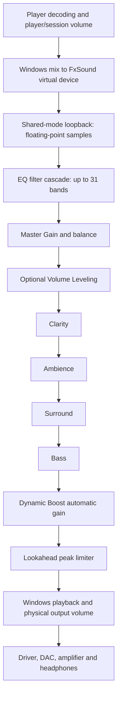

# How evlsound processes audio

This audit describes the FxSound 1.2.13.0 engine inherited by evlsound, based on upstream commit `d2a01f7396b0e23bbbd15cfd9fc26617f6a6a3a4`. evlsound extends Master Gain to **-60 through +20 dB**. It leaves the effects and limiter algorithms unchanged.

Source inspection explains the intended processing. It does not tell us whether a particular song, headphone, or listening session is clipping.

## The signal path



This is the ordinary stereo path, with EQ enabled and legacy binaural/vocal-removal options inactive. Master Gain is **after the EQ filters, before the effects and maximizer**. It therefore acts as a preamp for those later stages. The floating-point EQ calculations have no explicit full-scale clamp between the filters and master attenuation. Disabling the complete EQ chain also bypasses its master gain and leveling.

Sources: [EQ dispatch](../dsp/ptutil/dfxp/dfxpProcessReal.cpp), [EQ/master processing](../dsp/ptutil/SOS/SosProcess.cpp), [effect order](../dsp/ptechDsp/Play/Play32/Play32.c).

## What the five effects do

| Control | Processing | What changes |
|---|---|---|
| Clarity | Filtering, a sine nonlinearity that generates harmonics, and mixing with the original | Timbre and apparent brightness; it cannot recover information lost to a codec |
| Ambience | Reverb, with decay and wet/dry mixing | Space, tails, peaks and total level |
| Surround | Mid/side gain: more stereo difference, less common center signal | Width and center/side balance; this implementation is not the old delay-based widener |
| Bass | A parametric boost centered at **90 Hz**, **Q 2.5**, up to **+15 dB** before legacy mode adjustments | A focused bass lift separate from the EQ; potentially much more level into the limiter |
| Dynamic Boost | Broadband level-dependent gain, followed by peak limiting | Average level and transient behavior across the signal |

Sources: [Clarity](../dsp/ptechDsp/Aural/Aural032/Auralp32.c), [Ambience control](../dsp/ptutil/dfxp/dfxpComm.cpp), [Surround](../dsp/ptechDsp/wide/Wide32/Wide32.c), [Bass constants](../dsp/ptutil/include/c_play.h), [Bass filter](../dsp/ptutil/dfxp/dfxpQnt.cpp).

Setting an optional effect to zero disables its control. **Dynamic Boost zero does not bypass the maximizer.** The maximizer runs whenever the main effects-processing path runs. [Effect setter](../dsp/DfxDspPrivate.cpp), [always-run stage](../dsp/ptechDsp/Play/Play32/Play32.c).

## Dynamic Boost is not a decibel slider

The slider passes through MIDI rounding, a legacy mode adjustment, truncation, and a discrete gain lookup. The source defaults to Music Mode 2. A persisted mode setting can change the intermediate mapping.

| Slider | Requested gain in default mode | Amplitude multiplier |
|---:|---:|---:|
| 0 | 0.0 dB | 1.0000 |
| 1 | 1.6 dB | 1.2023 |
| 2 | 3.1 dB | 1.4289 |
| 3 | 4.7 dB | 1.7179 |
| 4 | 6.6 dB | 2.1380 |
| 5 | 10.0 dB | 3.1623 |
| 6-10 | 11.6 dB | 3.8019 |

The plateau at 6-10 is inherited behavior. Music Mode 1 omits the 1.8 multiplier and instead requests approximately `0, 0.9, 1.7, 2.6, 3.5, 4.4, 5.3, 6.4, 8.2, 9.8, 11.6 dB` at integer settings 0-10. Presets can store intermediate values while the GUI rounds their display. These tables describe source mapping, not a measurement of a current runtime mode.

Default mapping for integer slider `s`:

```text
u = float(s / 10)
m = int(float(127*u + 0.5))
w = min(127, int(float(1.8*m)))
k = int(float(0.7*w))
G = float(10^(lookup_dB[k]/20))
```

Sources: [knob conversion](../dsp/ptutil/dfxp/dfxpSet.cpp), [mode and boost adjustment](../dsp/ptutil/dfxp/dfxpComm.cpp), [gain lookup](../dsp/ptutil/Qnt/Qntitor.cpp), [default mode](../dsp/ptutil/dfxp/dfxpGet.cpp).

## Automatic gain before peak limiting

The maximizer estimates power from the **left input channel**, with a 0.1 Hz detector cutoff: nominal power-estimator time constant about 1.59 seconds. A nearby 0.06 Hz comment is stale. Both channels receive the resulting common gain.

Let `R` be the square root of that smoothed power, and `G` the requested amplitude gain above:

```text
if G*R <= 0.32:
    g = G
else:
    g = max(0.32/R, 1.06)
```

`0.32` is a smoothed level target, not the peak ceiling. This is feed-forward control based on input level, not feedback from output RMS. Sustained louder input can reduce actual gain below the requested value. The automatic branch has an unusual minimum gain of `1.06` (about +0.506 dB). At Dynamic Boost 0, sufficiently high RMS can therefore switch from gain 1 to gain 1.06; zero is not an exact unity-gain bypass.

Sources: [detector and gain calculation](../dsp/ptechDsp/Maximizer/Maxi32/Maxi32.c), [target and cutoff](../dsp/ptutil/include/c_max.h).

## The peak limiter

The inherited sample-peak ceiling is `C = 0.966051`, about **-0.30 dBFS**. Before each channel's lookahead delay, the signal is multiplied by `C*g`. A peak envelope then controls the delayed signal:

```text
if envelope <= C:
    output = delayed_sample
else:
    output = delayed_sample * C / envelope
```

Each channel has its own fast peak envelope, although both share the slow gain detector. Asymmetric peaks can receive different gain reduction. Lookahead is `trunc(0.00075*sample_rate)`: 33 samples at 44.1 kHz and 36 at 48 kHz. Envelope release has an approximately 10.18 ms time constant. These numbers are not the complete app latency or a fixed length for audible gain reduction.

This is sample-peak limiting, **not oversampled true-peak limiting**. At low levels, with no automatic backoff or peak reduction, setting 0 yields about -0.30 dB net and setting 10 yields about +11.30 dB net, plus delay. Other Windows/device processing can occur afterward.

Sources: [initialization](../dsp/ptechDsp/Play/Play32/Play32.c), [limiter implementation](../dsp/ptechDsp/Maximizer/Maxi32/Maxi32.c), [lookahead/release control](../dsp/ptutil/dfxp/dfxpComm.cpp).

## Why lower preamp plus higher playback volume can help

Master Gain multiplies the signal by `10^(dB/20)`: -20 dB is 0.1, -40 dB is 0.01, and -60 dB is 0.001. This creates additional **input-referred headroom** before the later processors. The output ceiling stays fixed.

With fixed downstream gain, reducing master by 10 dB makes the source need 10 dB more level to reach the limiter. Increasing physical output volume afterward can restore listening loudness without restoring that internal drive.

**Dynamic Boost can counteract part of this change.** In its settled automatic region, `g=0.32/R`; reducing master reduces `R`, so automatic gain rises inversely. Once gain reaches its requested maximum `G`, further attenuation passes through normally. Master also changes the drive into nonlinear Clarity processing. Consequently, lower master is not guaranteed to change only volume.

FxSound uses ordinary WASAPI loopback, which Windows documents as tapping the mix before endpoint master volume/mute. The application synchronizes virtual and physical endpoint volume controls. The expected result is that the laptop slider adjusts downstream listening level without raising the captured DSP input. This is supported by the source/API contract, not a live measurement on every driver. The volume control may be implemented in hardware or software.

Sources: [Windows loopback contract](https://learn.microsoft.com/en-us/windows/win32/api/audioclient/ne-audioclient-audclnt_streamoptions), [capture setup](../audiopassthru/src/sndDevices/sndDevicesSetupDevices.cpp), [volume synchronization](../audiopassthru/src/sndDevices/sndDevicesVolCallbacks.cpp).

Available output volume, downstream noise/conversion, and amplifier/headphone limits still matter. More attenuation is not automatically better once internal peaks already avoid limiting.

## Offline headroom test

[The regression test](../tests/maximizer_headroom_test.cpp) sends a four-second 1 kHz, deliberately **5.0-peak floating-point synthetic stress signal** through the real EQ/master and maximizer functions. It uses maximum Dynamic Boost's 3.801894 requested multiplier and leaves the ceiling unchanged.

| Master | Maximum output sample | Frames with limiter active, out of 176400 |
|---:|---:|---:|
| -20 dB | 0.966051 | 16023 |
| -40 dB | 0.183641 | 0 |
| -60 dB | 0.018364 | 0 |

This demonstrates additional headroom in the compiled processing functions. It is **not a measurement of the user's music, EQ curve, hardware, or subjective sound**. The test opens no audio device and accesses no application profile.

## Clipping and bit depth elsewhere

- Normal capture/processing/playback uses floating-point samples. Legacy `short int*` interface types do not imply conversion to 16-bit samples.
- The EQ/master stage has no explicit +/-1 clamp. Finite intermediate values can exceed nominal full scale and be attenuated afterward.
- **Volume Leveling has its own hard clamp when enabled**, with an effective ceiling around 0.92-1.0. Zero bypasses it.
- The legacy "force legal values" helper is skipped on the normal virtual-device path. In other paths it checks +/-100 and substitutes a prior sample; it is not the ordinary full-scale limiter.
- Maximizer initialization contains 16-bit/dither constants, but the quantization block is gated by `quantize_on_flag`. This audit found zero-initialized flag memory and no enabling write in the traced path. Those constants do not establish active 16-bit quantization.
- Playback submits floats; Windows and hardware can convert them afterward. Negotiated formats, runtime flags, inter-sample peaks, driver/APO processing and hardware limits were not measured here.

Sources: [processing dispatch](../dsp/ptutil/dfxp/dfxpUniversal.cpp), [leveling and clamp](../dsp/ptutil/SOS/SosProcess.cpp), [normal-path flags](../dsp/ptutil/dfxp/dfxpProcessReal.cpp), [guarded quantizer](../dsp/ptechDsp/Maximizer/Maxi32/Maxi32.c), [zeroed parameter memory](../dsp/ptComSftDfx/ComsftwrCPP.cpp), [playback submission](../audiopassthru/src/sndDevices/sndDevicesDoPlayback.cpp).

## Bass, loudness and perceived punch

EQ/Bass decide which frequencies drive the dynamics stages most strongly. Dynamic Boost can make sustained body more prominent while controlling peaks; it can also reduce contrast between a kick's initial hit and its tail. These are engineering interpretations, not listening-test findings.

Overlapping EQ bands combine, so the largest individual slider is not the complete peak boost. A useful listening comparison holds perceived output loudness approximately equal, preserves the EQ, and varies only master and Dynamic Boost while measuring peaks and limiter reduction. That live comparison has not been performed for this build.
